<div align="center">

# Digitra AI

### Ellerle öğren. Harflerle anlat.

**Türk İşaret Dili (TİD) parmak alfabesini 3D ellerle öğreten, kamerayla gerçek zamanlı tanıyan ve metni sese dönüştüren uçtan uca yapay zekâ platformu.**

[](LICENSE)
[](#-lisans)


<br/>

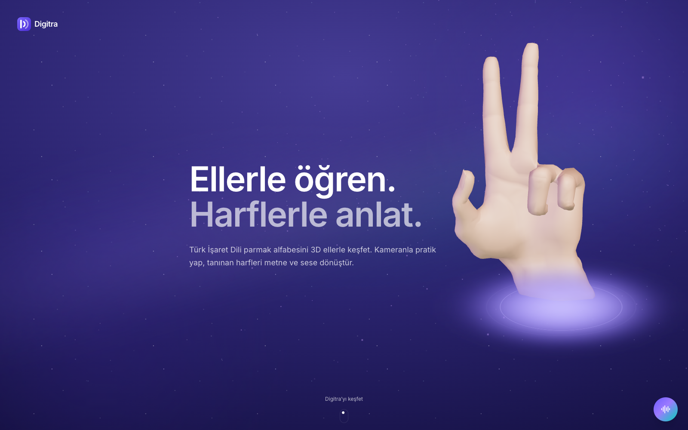

</div>

---

## 📑 İçindekiler

- [Proje hakkında](#-proje-hakkında)
- [Öne çıkan özellikler](#-öne-çıkan-özellikler)
- [Yenilikçi çözümler](#-yenilikçi-çözümler)
- [Ekran görüntüleri](#-ekran-görüntüleri)
- [Mimari](#-mimari)
- [Model ve ölçümler](#-model-ve-ölçümler)
- [Kurulum](#-kurulum)
- [API uç noktaları](#-api-uç-noktaları)
- [Proje yapısı](#-proje-yapısı)
- [Sınırlar ve dürüst raporlama](#-sınırlar-ve-dürüst-raporlama)
- [Geliştirici](#-geliştirici)
- [Lisans](#-lisans)

---

## 💡 Proje hakkında

Türkiye'de işitme engelli bireylerle iletişimin ilk adımı çoğu zaman **parmak alfabesi**dir; ancak TİD'i öğrenmek için erişilebilir, etkileşimli ve Türkçe kaynak çok azdır. Mevcut uygulamaların büyük kısmı Amerikan İşaret Dili'ne (ASL) odaklanır ve TİD'in **iki elli**, **hareketli** harflerini (Ç, Ğ, İ, J, Ö, Ş, Ü) desteklemez.

**Digitra** bu boşluğu üç ayaklı bir yaklaşımla kapatır:

| | Ayak | Ne yapar? |
|:-:|---|---|
| 👀 | **Görerek öğren** | 29 TİD harfinin her biri, döndürülebilir ve yavaşlatılabilir **3D el animasyonlarıyla** gösterilir. |
| ✋ | **Yaparak pekiştir** | Kamera açılır, el tarayıcıda tespit edilir ve gösterilen harf **gerçek zamanlı** tanınıp metne eklenir. |
| 🔊 | **Anlat ve duy** | Söylenen ya da yazılan kelime 3D ellerle **harf harf hecelenir**; oluşan metin **sesli** okunur. |

---

## ✨ Öne çıkan özellikler

- 🎥 **Canlı harf tanıma** — MediaPipe ile bir veya iki el bulunur, CNN ensemble'ı 29 harfi tahmin eder; ilk üç aday, güven, kararlılık, gecikme ve FPS anlık gösterilir.
- 🖐️ **29 harflik 3D TİD alfabesi** — İki elli ve hareketli harfler dahil; 0.5× / 1× / 1.5× hız, tekrar ve farklı bakış açıları.
- 🗣️ **Ses → İşaret** — Mikrofona söylenen ya da yazılan kelime 3D ellerle parmak alfabesiyle hecelenir.
- 🏆 **Kendini dene** — Rastgele harf testi; yapılan harf kamerayla doğrulanır.
- 🌱 **Canlı kelime atölyesi** (`/egitim/canli`) — Kelimeleri 3D rehberi taklit ederek harf harf çalışma.
- 📈 **Kişiselleştirilmiş öğrenme** — "Sana özel" paneli, en çok zorlanılan harfleri öne çıkarır.
- 🎙️ **Sesli asistan** — "Eğitime git", "kamerayı aç", "merhaba yaz" gibi komutlar **tarayıcıda, çevrimdışı** çözülür; serbest sorular isteğe bağlı olarak bir LLM servisine yönlendirilir.
- 🌗 **Erişilebilirlik** — Açık/koyu/sistem teması, azaltılmış hareket desteği, klavyeyle kullanılabilen kontroller, ekran okuyucu dostu etiketler.
- 🔒 **Gizlilik öncelikli** — Tam kamera karesi hiçbir zaman gönderilmez, hiçbir görüntü kaydedilmez.

---

## 🚀 Yenilikçi çözümler

### 1. Kırpılmış el görüntüsü + landmark hibrit tanıma
Klasik yaklaşımlar ya yalnızca el noktalarını (landmark) ya da tüm kamera karesini kullanır. Digitra ikisini birleştirir: tarayıcıdaki MediaPipe elleri bulur, **iki eli tek bir ortak kareye kırpar** (320×320 JPEG) ve yalnızca bu kırpımı yerel API'ye yollar. Böylece model arka plandan bağımsız, elin dokusuna ve parmak örtüşmesine odaklanan bir görüntü alır; landmark'lar ise hareket ve kararlılık takibinde kullanılır.

### 2. Örtüşen ellerde bağlamı koruyan kırpıcı
TİD'de birçok harf iki elin **birbirine değmesiyle** oluşur ve bu durumda MediaPipe sıklıkla yalnızca tek eli bulur. Digitra'nın kırpıcısı, ikinci el kaybolsa bile önceki karelerdeki konumu kullanarak **iki elin bağlamını kadrajda tutar**.

### 3. Ölçek ve aynalı TTA'lı CNN ensemble
Canlı model, doğrulama macro F1'ine göre seçilmiş **%25 MobileNetV3-Large + %75 EfficientNet-B0** ensemble'ıdır. Her tahmin **0,82 / 1,00 / 1,18 ölçek** ve **yatay ayna** ile test-time augmentation'dan geçer; bu sayede sağ/sol el ve farklı kamera mesafeleri tek modelle desteklenir.

### 4. Titreşimsiz harf yazımı: kararlılık kapıları
Ardışık tahminler; olasılık yumuşatma, en az üç kare kararlılık, güven eşiği ve sınıf marjı kontrollerinden geçer. **"El bırakma kapısı"** sayesinde tutulan bir poz aynı harfi tekrar tekrar eklemez. Sonuç: titremeyen, kullanıcının kontrolünde ilerleyen bir metin tamponu.

### 5. Hareketli harfler için zaman serisi takibi
Ç, Ğ, İ, J, Ö, Ş ve Ü için tek kare yeterli değildir. Digitra bu harflerde **30 karelik landmark penceresi** üzerinde temporal bir model ve parmak hareketi kuralları çalıştırır (deneysel katman).

### 6. Fizik bilinçli 3D el rig'i
3D eller sıradan animasyon değildir: özel bir **TİD rig'i**, SDF tabanlı yuvarlatılmış el yüzeyi, **çarpışma yüzeyi** ve **temas koruyucu** (`contact-guard`) sayesinde parmaklar birbirinin içinden geçmez, gerçek temas noktalarında durur. Pozlar zaman çizelgesine "bake" edilir ve WebXR uyumlu GLB olarak sunulur.

### 7. 3D ellerden sentetik eğitim verisi
Sitedeki aynı 3D el pozları, **5 bakış açısı × 3 ten/ışık varyasyonuyla** render edilerek modele **düşük ağırlıklı (0,20) yardımcı veri** olarak eklenir. Eğitim ve öğretim aynı kaynaktan beslenir: *"Aynı eller, iki farklı katkı."*

### 8. Bilimsel olarak dürüst eğitim hattı
V6 eğitim hattı; SHA-256 ve pHash ile **yakın kopya denetimi**, ardışık kare gruplarını koruyan veri ayrımı, EMA, sıcaklık kalibrasyonu, **testten önce kilitlenen model seçimi** ve 8 farklı bozulma koşulunda dayanıklılık testi içerir. Her sonuç, ölçüm koşuluyla birlikte model kartında raporlanır.

### 9. Yerel ve çevrimdışı öncelikli çalışma
Tanıma, yerel FastAPI servisinde (CUDA varsa GPU'da, yoksa CPU'da) çalışır. Konuşma tanıma ve seslendirme varsayılan olarak **tamamen tarayıcıda** yapılır; API anahtarı gerektirmez.

---

## 📸 Ekran görüntüleri

<table>
<tr>
<td width="50%">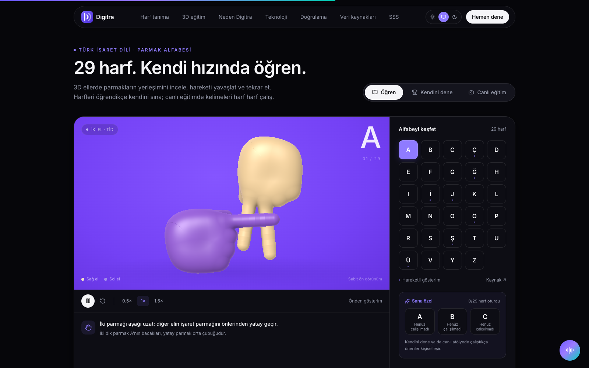<p align="center"><b>3D TİD alfabesi</b> — 29 harf, iki elli gösterim</p></td>
<td width="50%">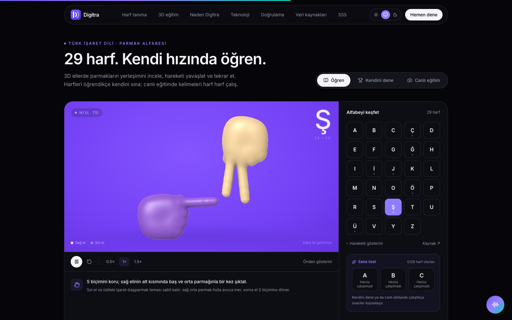<p align="center"><b>Hareketli harfler</b> — Ş harfi ve adım adım açıklama</p></td>
</tr>
<tr>
<td width="50%">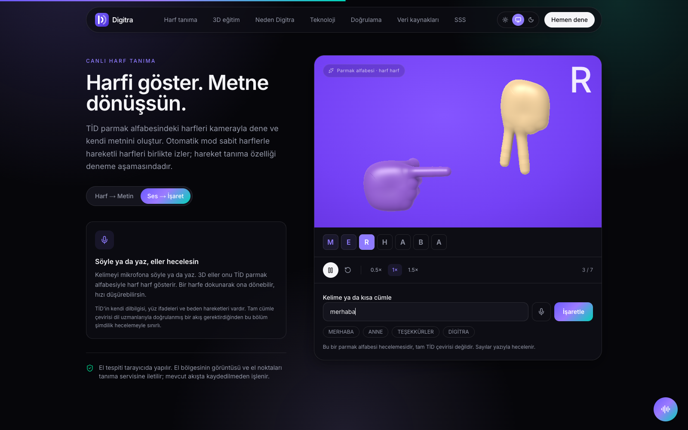<p align="center"><b>Ses → İşaret</b> — "merhaba" kelimesinin hecelenmesi</p></td>
<td width="50%">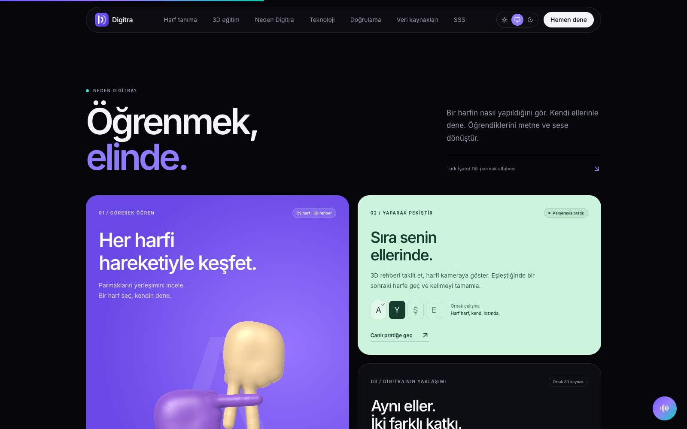<p align="center"><b>Neden Digitra?</b> — Görerek öğren, yaparak pekiştir</p></td>
</tr>
<tr>
<td width="50%">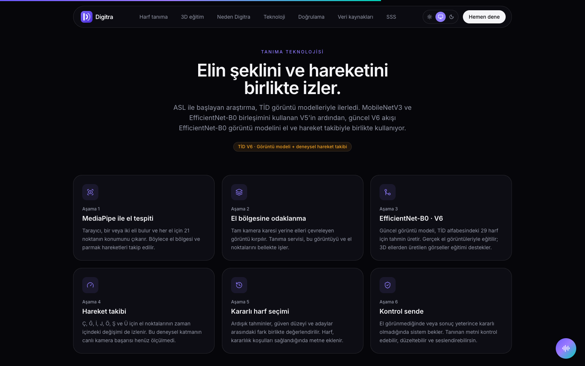<p align="center"><b>Tanıma hattı</b> — 6 aşamalı mimari</p></td>
<td width="50%">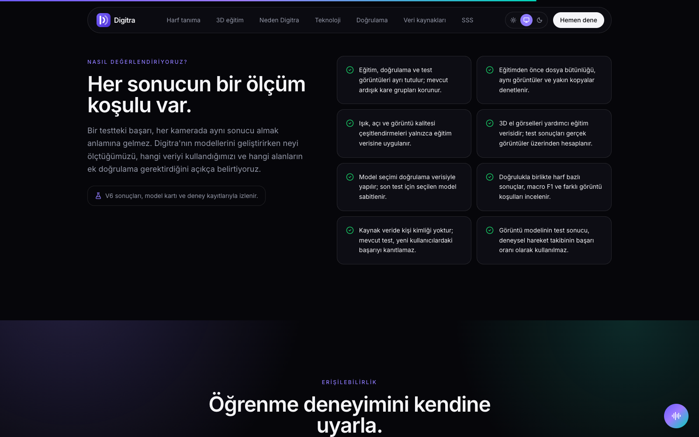<p align="center"><b>Doğrulama</b> — Her sonucun bir ölçüm koşulu var</p></td>
</tr>
<tr>
<td colspan="2">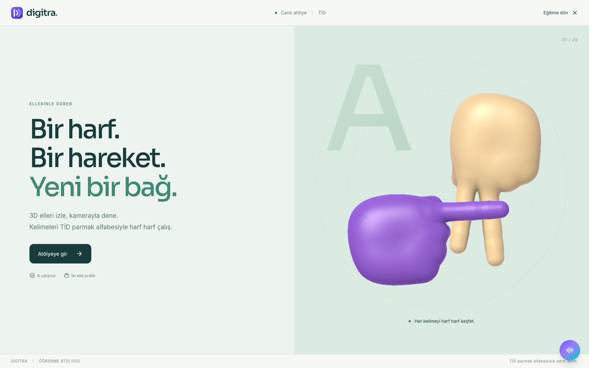<p align="center"><b>Canlı kelime atölyesi</b> — <code>/egitim/canli</code></p></td>
</tr>
</table>

---

## 🏗️ Mimari

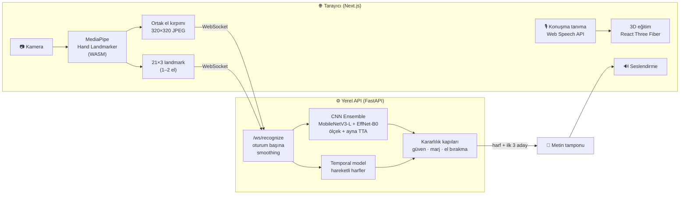

**Tanıma hattı adım adım:**

1. **El tespiti** — MediaPipe, tarayıcıda bir veya iki el için 21 noktanın konumunu çıkarır.
2. **El bölgesine odaklanma** — Tam kare yerine elleri çevreleyen bölge kırpılır.
3. **Görüntü modeli** — CNN ensemble'ı 29 harf için olasılık üretir.
4. **Hareket takibi** — Hareketli harflerde landmark'ların zaman içindeki değişimi izlenir.
5. **Kararlı harf seçimi** — Güven, aday marjı ve kare kararlılığı birlikte değerlendirilir.
6. **Kontrol sende** — Kullanıcı metni düzeltebilir, boşluk ekleyebilir ve seslendirebilir.

---

## 📊 Model ve ölçümler

Depoda üç model paketi bulunur:

| Model | Görev | Mimari | Sonuç |
|---|---|---|---|
| `digitra-tid-robust-v5` *(canlı API varsayılanı)* | 29 harf TİD, statik görüntü | %25 MobileNetV3-L + %75 EfficientNet-B0, TTA | Test doğruluğu **%89,10**, macro F1 **%88,98** |
| `digitra-tid-augmented-v6` | 29 harf TİD, statik görüntü | EfficientNet-B0 + kapsamlı augmentation | Test doğruluğu **%90,26**, macro F1 **%90,23**, medyan gecikme **20,4 ms** |
| `digitra-landmark-personal-v1.0.0` | Eski istemciler için yedek yol | Landmark sınıflandırıcı + temporal model | Tek kullanıcı, kişisel uyarlama |

### V6 dayanıklılık testleri

| Koşul | Doğruluk | Macro F1 |
|---|---:|---:|
| Temiz | %90,26 | %90,23 |
| Ayna | %90,26 | %90,23 |
| Uzak el | %86,54 | %86,73 |
| Kaydırma | %89,79 | %89,76 |
| Dönüş | %89,33 | %89,21 |
| Düşük ışık | %90,95 | %90,80 |
| Bulanıklık | %89,10 | %89,14 |
| JPEG bozulması | %89,33 | %89,24 |

<table>
<tr>
<td width="55%">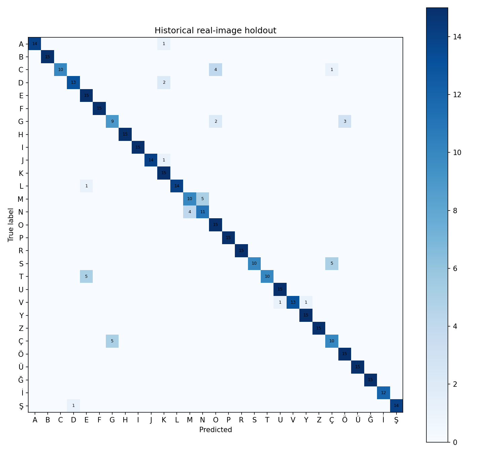<p align="center"><b>Karışıklık matrisi</b> — 431 gerçek test görüntüsü</p></td>
<td width="45%">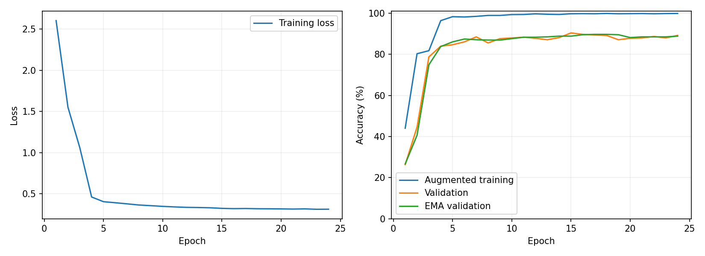<p align="center"><b>Eğitim eğrileri</b> — kayıp, doğrulama ve EMA doğrulaması</p></td>
</tr>
</table>

> Ayrıntılı ölçümler, harf bazlı sonuçlar ve sınırlar her modelin `models/<model>/model_card.md` dosyasında yer alır.

---

## 🛠️ Kurulum

### Gereksinimler
- Python **3.12**
- Node.js **LTS** (20+)
- *(İsteğe bağlı)* NVIDIA GPU + CUDA — yoksa CPU'da çalışır

### ⚡ Windows'ta tek tıkla

1. `kurulum.cmd` dosyasına çift tıklayın (ilk seferde paketleri indirir, NVIDIA kart varsa CUDA'lı PyTorch kurar).
2. `run_digitra_ai.cmd` ile başlatın; tarayıcıda `http://127.0.0.1:3000` açılır.

Başlatıcı, API, model ve web hazır olana kadar bekler; hata olursa ayrıntıyı ekranda ve `output/runtime-logs/` altında bırakır.

### 🐧 Manuel kurulum (macOS / Linux / Windows)

**1. API**

```bash
cd apps/api
python -m venv .venv-digitra
source .venv-digitra/bin/activate          # Windows: .venv-digitra\Scripts\activate
pip install -r requirements.txt
# NVIDIA GPU için (isteğe bağlı):
pip install --force-reinstall --no-deps -r requirements-cuda.txt
cp .env.example .env
uvicorn app.main:app --port 8001 --reload  # http://localhost:8001
```

**2. Web**

```bash
cd apps/web
npm install
npm run dev                                # http://localhost:3000
```

### Kullanım ipuçları
- Canlı panelde önce **"Model bağlantısı açık"** durumunu kontrol edin.
- Kamerayı başlatın ve harfi **1–2 saniye sabit** tutun.
- Yeni harf için ellerinizi kısa süre indirin; aynı harf tekrar eklenmez.

---

## 🔌 API uç noktaları

| Yöntem | Yol | Açıklama |
|---|---|---|
| `GET` | `/health` | Servis ve model durumu |
| `GET` | `/models` | Yüklü model listesi |
| `GET` | `/model-metrics` | Model ölçümleri |
| `WS` | `/ws/recognize` | Gerçek zamanlı tanıma; her istemci için ayrı smoothing/metin oturumu |
| `POST` | `/predict` | Base64 JPEG/PNG/WEBP el kırpımından tek tahmin (landmark yedek yolu dahil) |
| `POST` | `/stt` · `/tts` | Konuşma ↔ metin köprüsü (varsayılan: tarayıcı) |
| `POST` | `/feedback` | Tahmin geri bildirimi |
| `GET` · `POST` | `/assistant/status` · `/assistant` | Sesli asistan |

Etkileşimli belgeler: `http://localhost:8001/docs`

---

## 📁 Proje yapısı

```
Digitra-AI/
├── apps/
│   ├── web/                    # Next.js 16 + TypeScript + Tailwind 4 + Framer Motion + R3F
│   │   ├── src/components/home # Ana sayfa bölümleri (çeviri, eğitim, mimari, doğrulama…)
│   │   ├── src/components/tid  # 3D el rig'i, pozlar, hareket ve temas koruyucu
│   │   ├── src/lib             # El tespiti, kırpma, konuşma, asistan, öğrenme ilerlemesi
│   │   ├── public/mediapipe    # Yerel MediaPipe WASM + hand_landmarker.task
│   │   ├── public/models       # 3D el GLB dosyaları
│   │   └── scripts             # 3D el üretimi, poz bake ve görsel test araçları
│   └── api/                    # FastAPI backend
│       ├── app/routers         # health, models, predict, recognition (WS), speech, feedback, assistant
│       ├── app/services        # TİD görüntü modeli, landmark modeli, çıkarım
│       └── tests
├── ml/training/tid_v6/         # V6 eğitim, augmentation, sentetik render, denetim ve testler
├── models/                     # Eğitilmiş model paketleri + model kartları
├── scripts/                    # Windows kurulum/başlatma betikleri
├── docs/images/                # README görselleri
├── kurulum.cmd
└── run_digitra_ai.cmd
```

### Teknoloji yığını

| Katman | Teknolojiler |
|---|---|
| **Ön yüz** | Next.js 16, React 19, TypeScript, Tailwind CSS 4, Framer Motion, Lucide |
| **3D** | Three.js, React Three Fiber, Drei, three-mesh-bvh, GLB/WebXR el varlıkları |
| **Bilgisayarlı görü** | MediaPipe Tasks Vision (Hand Landmarker, WASM) |
| **Arka uç** | FastAPI, Uvicorn, Pydantic, WebSocket |
| **Makine öğrenmesi** | PyTorch, torchvision, scikit-learn, NumPy, Pillow |
| **Ses** | Web Speech API (STT/TTS) |

---

## ⚠️ Sınırlar ve dürüst raporlama

Digitra, sonuçlarını abartmadan raporlamayı bir tasarım ilkesi olarak benimser:

- Kaynak veride kişi kimliği bulunmadığından ölçümler **kişi bağımsız (signer-independent) değildir**.
- Digitra **tam TİD cümle çevirisi yapmaz**; parmak alfabesiyle harf harf heceler. TİD'in kendi dilbilgisi, yüz ifadeleri ve beden hareketleri vardır.
- Hareketli harf tanıma **deneysel** aşamadadır; canlı kamera başarısı henüz ölçülmemiştir.
- 3D el gösterimlerinin TİD uzmanı doğrulaması henüz tamamlanmamıştır.
- Güven değeri bir model skorudur, doğruluk garantisi değildir.

---

## 👤 Geliştirici

<table>
<tr>
<td align="center">
<a href="https://github.com/furkhangul">
<br/>
<b>Furkan</b>
</a><br/>
<sub>Proje sahibi · Full-stack & ML geliştirici</sub>
</td>
</tr>
</table>

Katkılar, hata bildirimleri ve öneriler için [Issues](https://github.com/furkhangul/Digitra-AI/issues) sayfasını kullanabilirsiniz.

---

## 📄 Lisans

- **Kaynak kod:** [MIT Lisansı](LICENSE) © 2026 Furkan
- **Model ağırlıkları (`models/`):** Eğitim verisi [CC BY-NC-SA 4.0](https://creativecommons.org/licenses/by-nc-sa/4.0/) lisanslı olduğundan modeller yalnızca **araştırma ve ticari olmayan** kullanım içindir.
- **3D el varlığı:** [WebXR Input Profiles](https://github.com/immersive-web/webxr-input-profiles) generic-hand (MIT, © 2019 Amazon) temel alınarak uyarlanmıştır — bkz. `apps/web/public/models/THIRD_PARTY_HAND_LICENSE.md`.

<div align="center">
<br/>
<sub>Türk İşaret Dili'ni herkes için erişilebilir kılmak amacıyla ❤️ ile geliştirildi.</sub>
</div>
